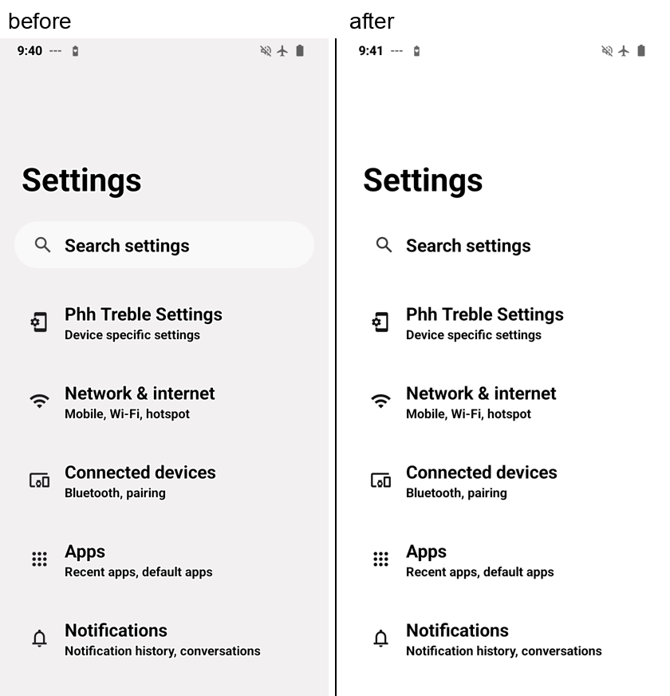
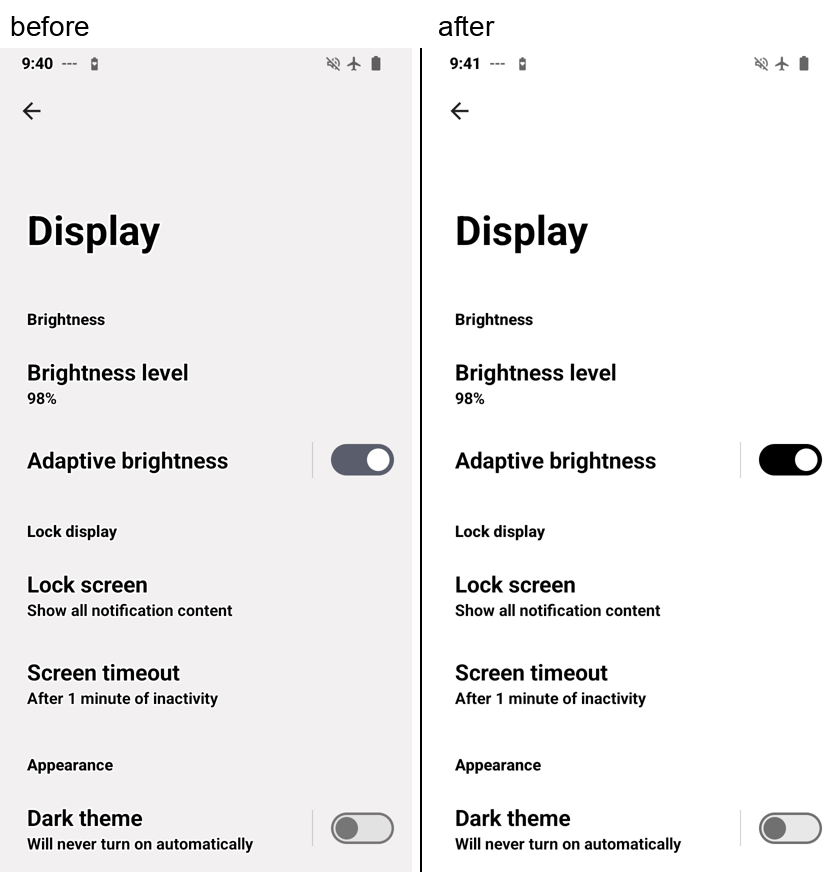
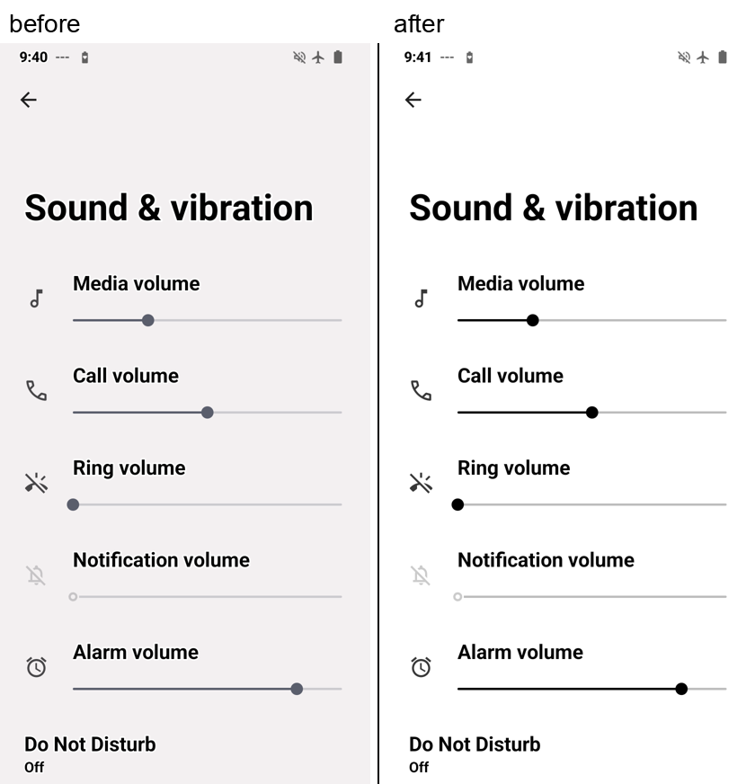
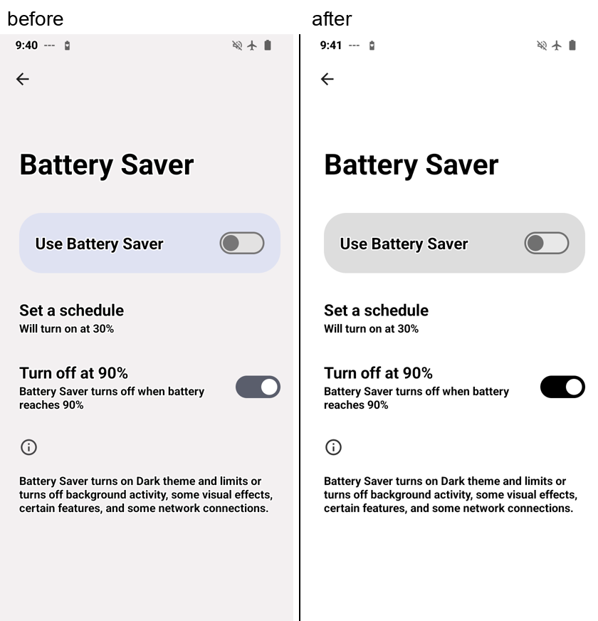
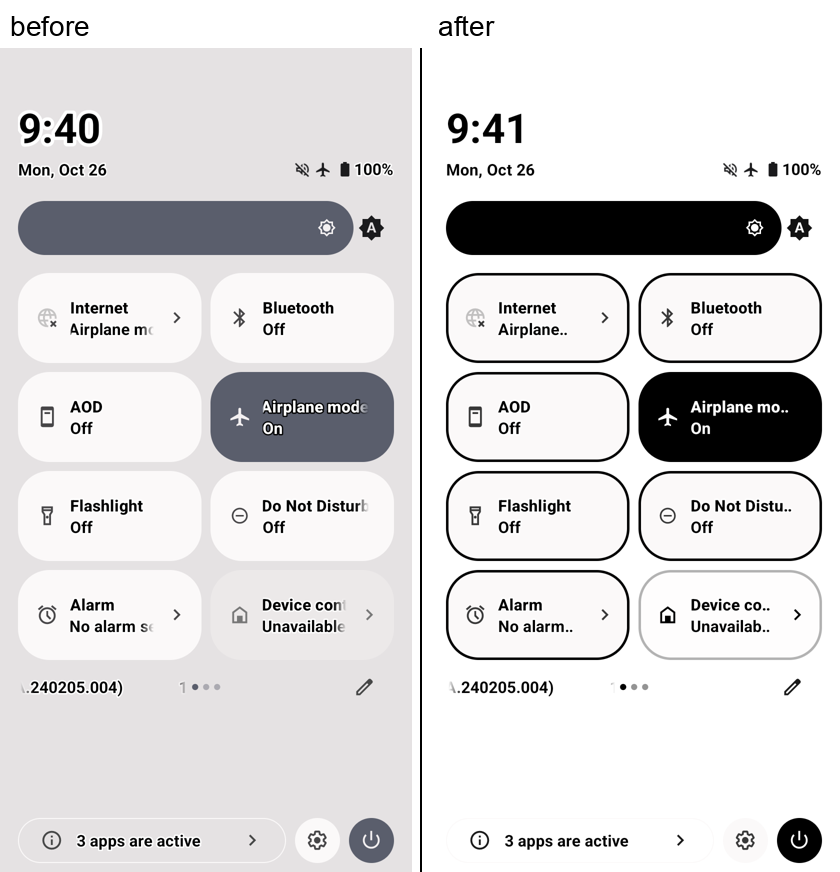
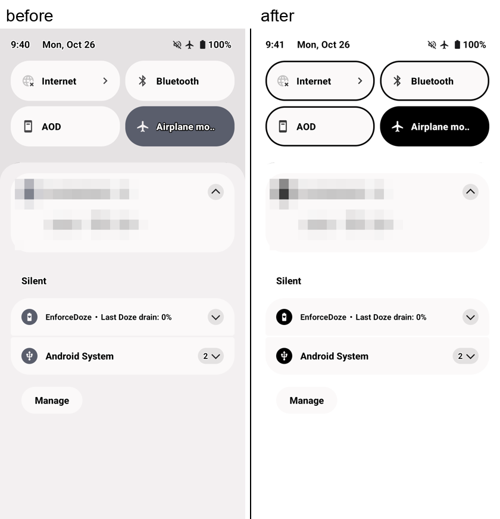

# hisense-a9-palette

A pure **white / black Android UI for the Hisense A9 e-ink phone** running LineageOS 21
(Android 14). It replaces Android's generated "Material You" palette, which comes out as tinted,
off-white backgrounds and mid-grey accents, with colours that suit an e-ink panel:

- white backgrounds, panels and cards; black text, icons, switches, sliders and outlines;
- untinted greys only where a container has to be distinguishable (e.g. the main on/off bar);
- optional: **black outlines on quick-settings tiles** (SystemUI resource overlay).

No ROM rebuild, no system partition edits: everything is a runtime overlay plus a small Magisk
boot script, and can be switched off with one command.

## Before / after

Same screens, before and after. Screenshots are captured *before* the display's grayscale filter,
so on the device the "before" tints show up as light grey rather than pink. "Before" is damianmqr's
default theme (style SPRITZ, grey preset); both sides also have the system's bold text and
high-contrast text settings on, which are not part of this repo.

| | |
|---|---|
|  |  |
|  |  |
|  |  |

Raw captures are in [`screenshots/before`](screenshots/before) and [`screenshots/after`](screenshots/after).

## What it works on

Tested on exactly one setup:

| | |
|---|---|
| Device | Hisense A9 (`HLTE556N`, Snapdragon 662 / `bengal`, 824×1648 e-ink, 360 dpi) |
| ROM | damianmqr's Hisense A9 LineageOS 21 image **v3.8, microG variant** (A9 service `com.lmqr.ha9_comp_service` 3.8.1), from the [XDA Hisense A9 thread](https://xdaforums.com/t/hisense-a9-root-snapdragon-662.4495809/) (image `lineageos_21_microg_ha9_unofficial_damianmqr_patched_v3_8.img`) |
| Base | LineageOS 21 TrebleDroid GSI `lineage_arm64_bvN` 21.0-20240217, Android 14 `UQ1A.240205.004`, security patch 2024-02-05 |
| Root | Magisk 30.7 |
| Vendor | stock Hisense Android 11 vendor (`L2037.6.01.01`) |

It should also work on the **gapps** and **vanilla** variants of the same image (the parts
involved are the same), and very probably on other **rooted Android 14 builds with AOSP SystemUI**
(the colour part is plain AOSP). It has not been tried anywhere else. Android 15 and later changed
the theme code; expect differences there. Quick-settings outlines depend on SystemUI's drawable
names, which are build-specific.

## Requirements

- Root through **Magisk** (the boot script uses Magisk's `service.d` and its busybox), with
  **Shell** allowed in Magisk → Superuser (`adb shell su` must work).
- A computer with `adb` and `python3`.
- Only for the optional outlines: Android SDK **build-tools** (tested 35.0.1: `aapt2`, `zipalign`,
  `apksigner`) and a **JDK 17+** (or Nix, which the build script falls back to). Android Studio is
  not needed.
- For regenerating the README comparison images only: Pillow (`pip install pillow`).

## Install

```sh
# 1. colours (+ boot script, + monochrome theme style)
scripts/install.sh                 # or: scripts/install.sh --keep-theme-style
scripts/status.sh                  # check: eink after com.android.systemui:*, colours #ffffffff/#ff000000

# 2. optional: quick-settings outlines (needs one reboot)
BUILD_TOOLS=~/Library/Android/sdk/build-tools/35.0.1 overlay-systemui/build.sh
scripts/install-outlines.sh        # installs the Magisk module, reboots, enables the overlay
```

Apps pick the new colours up immediately (they redraw on the configuration change); a reboot is
not needed for the colours.

**Changing colours:** edit [`palette/eink_palette.py`](palette/eink_palette.py) and run
`scripts/install.sh` again. **Changing the outline:** edit
[`overlay-systemui/res/drawable/qs_tile_background_shape.xml`](overlay-systemui/res/drawable/qs_tile_background_shape.xml),
rebuild, reinstall.

## Uninstall

```sh
scripts/uninstall.sh   # stops and removes the boot script, disables the palette, restores the
                       # previous theme style, marks the outline module for removal
adb reboot             # only needed to finish removing the outline module
```

Quick off switch without uninstalling: `adb shell su -c 'cmd overlay disable com.android.shell:eink'`
(the boot script leaves a disabled palette alone).

## How it works

Short version; details, the investigation and dead ends are in [docs/how-it-works.md](docs/how-it-works.md).

1. **Where the tint comes from.** On Android 12+ SystemUI's `ThemeOverlayController` generates
   three *fabricated* runtime overlays on the `android` package (`com.android.systemui:neutral`,
   `:accent`, `:dynamic`) that set the `system_neutral1_*`, `system_accent*_*` and Android 14's
   `system_*_light/dark` colour tokens from a seed colour. Every app using the Material 3 /
   DeviceDefault theme reads those. With this ROM's preset they gave e.g. a `#f3f0f1` Settings
   background.
2. **Palette overlay.** `palette/eink_palette.py` writes replacement values for the same 107
   colour resources (light mode only; dark-mode tokens are untouched). `scripts/install.sh`
   registers them as another fabricated overlay, `com.android.shell:eink`, with
   `cmd overlay fabricate --file` (root). When several enabled overlays set the same resource, the
   one registered last wins, so ours overrides SystemUI's.
3. **Boot script ("keeper").** SystemUI re-registers its overlays at boot, when it restarts and on
   every light/dark switch, which puts them back on top. `magisk/eink-palette.sh` runs from
   Magisk's `service.d`, waits for boot, re-registers the palette, then sleeps in busybox
   `inotifyd` on `/data/system`. When `overlays.xml` is rewritten it checks the order and, only if
   SystemUI's overlays are above ours, re-registers ours. It is event driven: no polling, no
   wakeups while the phone sleeps. A guard limits it to 3 re-registrations per minute.
4. **Theme style.** `install.sh` also sets SystemUI's palette style to `MONOCHROMATIC`, so the few
   colours SystemUI computes by itself (not via the overlaid resources) come out grey instead of
   tinted.
5. **Quick-settings outlines (optional).** Android 14's shell can only fabricate colour and integer
   values, so the outline is a classic resource overlay (RRO) APK targeting `com.android.systemui`.
   It replaces `drawable/qs_tile_background_shape` with the same rounded shape plus a 2 dp black
   stroke and `tintMode="multiply"`: SystemUI recolours the tile at runtime, and multiply changes
   the white fill to the tile colour but leaves the black stroke black. It is shipped as a Magisk
   module that places the APK in `/product/overlay`, because SystemUI declares no overlayable
   resources and only preinstalled overlays may target it.

## Risks

Read before installing.

- **Root-level changes to the system UI.** All of it can be undone with `scripts/uninstall.sh`, but
  you need working `adb` + root to do that. Keep USB debugging and Magisk's Shell grant enabled.
- **Flicker loop (fixed, but know the symptom).** An earlier version of the boot script decided
  "ours is not on top" from the wrong list position after switching to gesture navigation and
  re-registered itself in a loop: the whole screen flashed and the launcher and shade stopped
  responding. The current check compares only with SystemUI's overlays and has a hard limit of 3
  re-registrations per minute. If you ever see repeated full-screen redraws, run
  `adb shell su -c 'logcat -d -s eink-palette'`, then stop it:
  `adb shell su -c 'rm /data/adb/service.d/eink-palette.sh'` and reboot.
- **SystemUI resource overlay.** A broken SystemUI overlay can make SystemUI crash-loop (black or
  flashing status bar, no shade). Escape hatch over adb:
  `adb shell su -c 'touch /data/adb/modules/eink_systemui_overlay/disable' && adb reboot`, or boot
  Magisk safe mode. The shipped overlay only replaces one shape drawable.
- **Every re-registration redraws all apps** (it is a configuration change). Normally that happens
  once per boot and once per light/dark switch.
- **Dark mode.** Only light-mode tokens are replaced. Dark mode, including dark mode forced by some
  apps, keeps the stock dark palette.
- **ROM updates / other builds.** Resource names are stable within Android 14, but SystemUI
  drawables and theme internals change between versions and forks. After a ROM update, check
  `scripts/status.sh` before trusting it.
- **Leftover entry.** The fabricated overlay stays registered (disabled) after uninstalling;
  Android 14 offers no shell command to unregister it. It has no effect while disabled.
- **Not every app follows the system palette.** Apps with their own themes (many third-party apps)
  look exactly as before; the palette only changes apps that use the system colours (Settings,
  SystemUI, Material You apps).

## Limitations

- Fixed tinted spots: a few SystemUI surfaces (inactive tiles, notification cards) use colours
  computed in code at creation time and stay about 98 % white (`#fbf9f9`); with the grayscale
  filter that is indistinguishable from white.
- Outlines are added only to quick-settings tiles. Elsewhere you get the standard Material outlines
  (outlined buttons, text fields, switch tracks), now black.
- No GUI; install and changes go through `adb`.

## Related device configuration

Settings that make the A9 nicer to use alongside this (animations off, grayscale, warm front light
at night, quick pulldown, …) with the exact commands: [docs/configuration.md](docs/configuration.md).
Troubleshooting: [docs/troubleshooting.md](docs/troubleshooting.md).

## Repository layout

| Path | What |
|---|---|
| `palette/eink_palette.py` | palette definition → overlay XML (stdout) |
| `magisk/eink-palette.sh` | boot script / keeper (Magisk `service.d`) |
| `scripts/install.sh`, `uninstall.sh`, `status.sh` | install, remove, diagnose (over adb) |
| `overlay-systemui/` | quick-settings outline RRO: sources, `build.sh`, Magisk `module.prop` |
| `scripts/install-outlines.sh` | install the outline module, reboot, enable |
| `scripts/screenshots.sh`, `compare.py` | capture the README screens, build the side-by-side images |
| `tools/frro_dump.py` | decode SystemUI's generated `.frro` palettes (investigation aid) |
| `docs/` | how it works, device configuration, troubleshooting |
| `AGENTS.md` | notes for AI coding agents working on this repo |

## Credits

- damianmqr for the Hisense A9 LineageOS images and the A9 patching service.
- The TrebleDroid / phh-treble GSI project and LineageOS, on which the ROM is based.
- topjohnwu for Magisk.

## License

[GPL-3.0](LICENSE). You may use, change and share this, including modified versions, as long as
what you distribute stays under the GPL with its source available.
`overlay-systemui/res/drawable/qs_tile_background_shape.xml` is a modified copy of an AOSP file
(Apache-2.0, © The Android Open Source Project), which is compatible with GPL-3.0.
